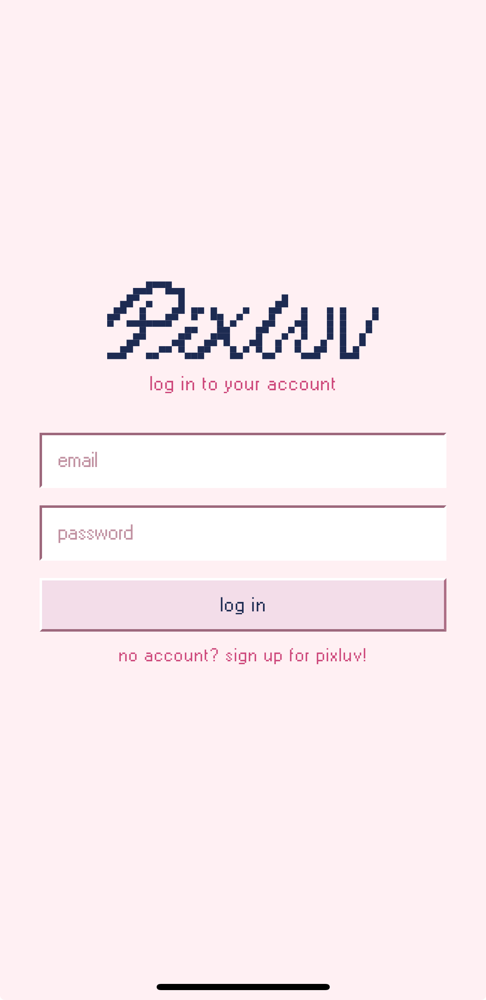
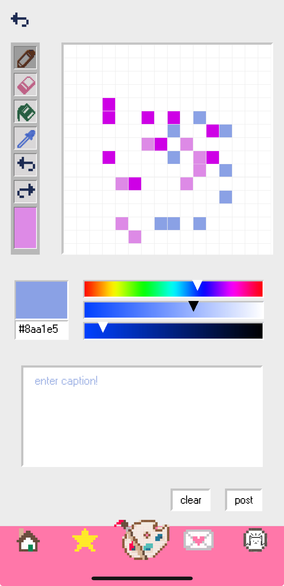

# Pixluv

A social app for pixel art: draw on a pixel canvas, share it to a feed, take on a daily drawing challenge, and message other artists. For lovers of pixels and creativity!

Built by a team of five for CS52 (Full-Stack Web Development) at Dartmouth. This repo combines the original client and API repos into one, with the full commit history kept.

# Demo


https://github.com/user-attachments/assets/a337b9c5-bdaa-4d2a-87a2-7a70a37135c8

## Screenshots

       

## Features

- **Accounts:** sign up and log in with JWT-based authentication
- **Feed:** browse posts from all users, with likes and comments
- **Create:** pick a canvas size (8×8, 16×16, 32×32) and draw with pixel tools and a color picker
- **Daily challenge:** draw to a daily prompt using only a limited set of colors and tools, then browse everyone's submissions by date
- **Pixing (messaging):** send direct messages, including drawings, to other users
- **Profiles:** profile picture, bio, color palette, followers/following, and a sticker collection
- **Stickers:** achievements unlocked for milestones like your first post, first comment, or completing a daily challenge

## Repo structure

```
pixluv/
├── app/   # Mobile client: React Native + Expo (Expo Router)
└── api/   # REST API: Express 5 + Prisma + PostgreSQL
```

## Architecture

```
React Native app (Expo)  ──REST + JWT──▶  Express API  ──Prisma──▶  PostgreSQL
        │                                     │
        └──── direct upload (presigned URL) ──┴──▶  AWS S3 (images)
```

- **Client (`app/`):** React Native with Expo and Expo Router for file-based navigation. Auth state lives in a React context (`context/AuthContext.tsx`), and the token is stored with `expo-secure-store`. All API calls go through `services/api.js`. Drawings are captured as images with `react-native-view-shot`.
- **API (`api/`):** Express 5 with controllers for auth, users, posts, challenges, and pixing (`src/controllers/`). Protected routes go through the `requireAuth` JWT middleware (`src/middleware/auth.js`). Passwords are hashed with bcrypt.
- **Data:** Prisma ORM on PostgreSQL. Models: `User`, `Follow`, `Post`, `Like`, `Comment`, `Chat`, `DailyChallenge` (`api/prisma/schema.prisma`).
- **Images:** the API issues presigned S3 URLs (`GET /sign-s3`), so the client uploads images directly to S3.

## Running locally

**API**
```bash
cd api
npm install
cp .env.example .env   # fill in DATABASE_URL, JWT_SECRET, and AWS/S3 values
npx prisma migrate dev
npm run dev
```

**App**
```bash
cd app
npm install
# create app/.env with: EXPO_PUBLIC_API_URL=http://<your-api-host>
npm start              # or: npx expo start --tunnel
```

## My contributions

I worked across both the API and the mobile client, usually building a feature end to end (schema → endpoints → UI).

- **Authentication (full stack):** password hashing with bcrypt, the auth controller (signup/login with JWTs), and the `requireAuth` middleware on the API. On the client: login/signup pages, an auth context, persistent sessions with `expo-secure-store`, and email validation
- **Client–API layer:** the shared API service (`app/services/api.js`) that every screen uses to call the backend, plus the initial client-to-backend connection and iOS network config
- **Users API:** the user controller and routes, user search by username, and the `DailyChallenge` schema and migration
- **Pixing / messaging (full stack):** the messaging schema, controller, and routes, plus the inbox and conversation screens, sending pixel art through a picker modal, and styling
- **Followers/following (full stack):** the `Follow` model and follow/unfollow/followers/following endpoints, plus the follow UI on both your own profile and other users' profiles
- **Profiles (full stack):** profile pictures (upload, and display on posts, comments, the feed, and chats), bio, profile editing, settings/logout, and profile pages for other users, which you reach by tapping an avatar
- **Stickers (full stack):** the stickers schema, a backfill for existing users, sticker definitions, an award helper (`app/utils/unlockSticker.ts`) wired into five milestones (first account, first post, daily challenge, sending a pix, first comment), and the sticker collection page
- **Expo setup and fixes:** Expo/EAS configuration, fixed bugs with mobile keyboard and login

## Pixluv Team

Annie Yuan, Bopha Um, Claire Chang, Laura Liu, Syed Masrur Ahmed
