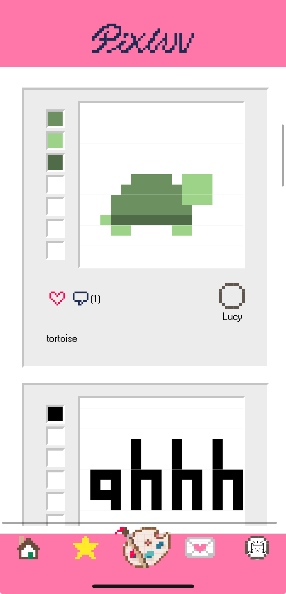
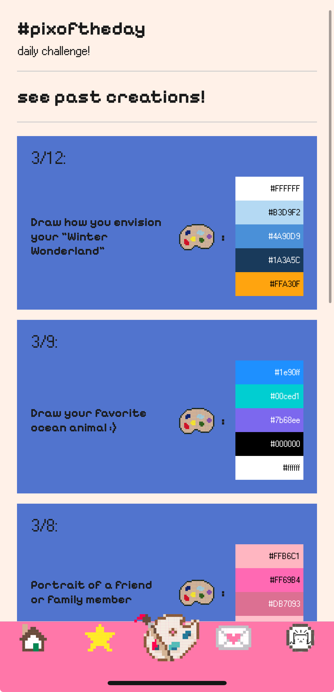
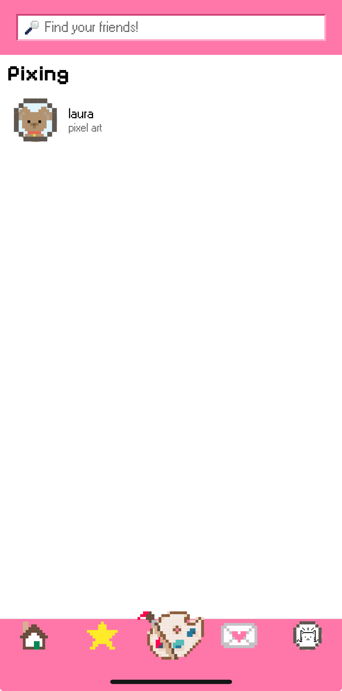
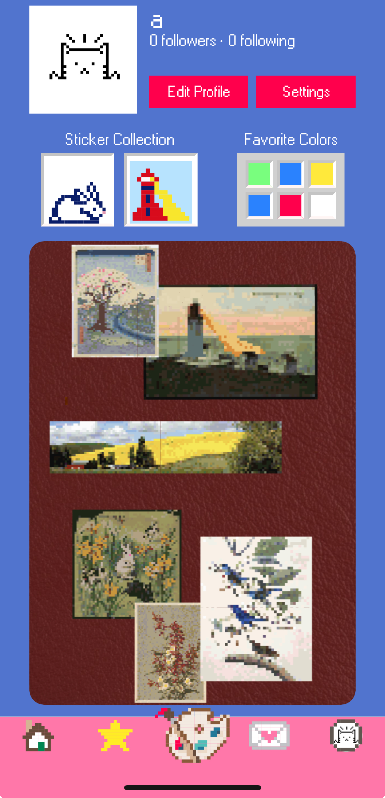

# Pixluv

  
A novel app that combines social media and art; for lovers of pixels and creativity!

Key screens (see below): 
* Log in/set up a Pixluv account
* Feed of all posts from different users
* Create post (a. choose canvas size b. access drawing tools to color the canvas
* Daily challenge (draw according to a prompt and a limited set of colors and tools)
* Messaging other users
* User profile

 

## Architecture
Tools and libraries used (for frontend):
React Native for mobile application development, Expo

## Setup

npm install && npm start

## Deployment

EXPO CREDENTIALS:  
username: pixluvapp@gmail.com  
password: pixluv@firstsight

## Authors

Annie Yuan, Bopha Um, Claire Chang, Laura Liu, Syed Masrur Ahmed

## Acknowledgments
Thank you to Tim and the TAs for a great term of CS52!
